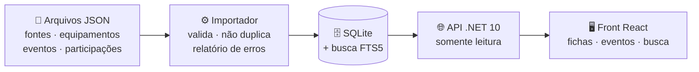

<div align="center">

# ⚓ ✈️ 🛡️ Poder Bélico

### O acervo de equipamentos militares do mundo — da 1ª Guerra Mundial aos dias de hoje

Navios, aviões e blindados de cada país, com **ficha técnica**, **fontes** e **selo de confiabilidade**,
ligados às **guerras, campanhas e batalhas** onde entraram em combate.


[Como rodar](#-como-rodar) · [O que tem](#-o-que-tem) · [API](#-api) · [Dados](#-dados-e-confiabilidade) · [Estrutura](#-estrutura)

</div>

---

## 🎯 A ideia

Quem pesquisa história militar acaba juntando dezenas de sites: um para o caça, outro para o tanque, outro
para a batalha onde ele apareceu. O **Poder Bélico** reúne tudo num só lugar:

- 🔎 **Cada equipamento tem uma ficha** com país, força, fabricante, anos, medidas, armamento, operadores e curiosidade.
- 🗓️ **Cada evento tem sua página**, com beligerantes por lado, subeventos (guerra → campanha → batalha) e os equipamentos usados.
- 🔗 **Os dois lados se conversam:** da ficha do A-10 você vai à Guerra do Golfo, e da Guerra do Golfo volta ao A-10.
- 🏷️ **Nada aparece sem fonte.** Dado que não é confirmado ganha um selo de alerta que leva à metodologia.

## ✨ O que tem

| | Recurso | Detalhe |
|---|---|---|
| 📋 | **Catálogo** | Lista com filtros por país, força, categoria, status e período, com paginação |
| 📄 | **Ficha técnica** | Medidas em unidade padrão e convertidas na exibição (mph, nós, pés, libras, kW…) |
| ⚔️ | **Eventos** | Guerras, campanhas e batalhas em árvore, em ordem cronológica, incluindo conflitos em andamento |
| 🕰️ | **Linha do tempo** | De 1914 até hoje, agrupada por guerra |
| 🌍 | **Páginas por país** | Uma seção para Marinha, Força Aérea e Exército |
| 🧭 | **Filtro por força** | Fica na URL e acompanha você entre as páginas |
| 🔍 | **Busca** | Por nome e descrição, sem diferenciar maiúsculas nem acentos (“jutlandia” acha a Jutlândia) |
| 🏷️ | **Fontes e selo de confiabilidade** | Confirmado, estimado ou contestado, com página de metodologia |
| 📱 | **Feito para o celular** | Testado em tela de 360 px, sem rolagem horizontal |
| 📥 | **Importador idempotente** | Reimportar não duplica; erro em um registro não derruba o lote |

## 🧱 Como funciona



- **Banco em unidade padrão** (km/h, kg, m, km). A conversão acontece só na hora de mostrar.
- **Ordem de importação:** fontes → equipamentos → eventos (pai antes do filho) → participações.
- **Participação** = equipamento + evento + país. O país precisa ser beligerante do evento, senão o registro é rejeitado.
- **Ficha só com fonte provisória nunca fica “confirmada”:** é gravada como “estimada”, com aviso.

## 🚀 Como rodar

**Precisa de:** .NET 10 SDK, Node.js 22+ e PowerShell.

```powershell
# 1) Primeira vez: pacotes, migration inicial e dependências do front
./configurar.ps1

# 2) Carregar as fichas e os eventos de exemplo
./importar.ps1 dados/importacao/aeronaves dados/importacao/blindados dados/importacao/navios
./importar.ps1 dados/exemplos dados/exemplos-eventos

# 3) Subir a API e o front (dois terminais)
dotnet run --project src/PoderBelico.Api --urls http://localhost:5080
cd web; npm run dev
```

Abra **http://localhost:5173** 🎉

<details>
<summary>🧪 Rodar os testes</summary>

```powershell
dotnet test                 # API, importador e validação dos esquemas
cd web; npx vitest run      # interface
```

Mapa do que cada teste cobre: [`docs/COBERTURA-DE-TESTES.md`](docs/COBERTURA-DE-TESTES.md)

</details>

<details>
<summary>📦 Publicar</summary>

```powershell
./publicar.ps1
```

Gera o build do React, copia para o `wwwroot` da API e publica em `./publicado`.

</details>

<details>
<summary>📥 Opções do importador</summary>

```powershell
./importar.ps1 dados/exemplos --simular    # valida sem gravar
./importar.ps1 dados/importacao --estrito  # qualquer rejeição desfaz tudo
```

Também aceita `--banco`, `--paises` e `--relatorio arquivo.json`. O código de saída é 1 se algum registro for rejeitado.

</details>

## 🌐 API

Somente leitura, em JSON.

```
GET /api/equipamentos?pais=&forca=&categoria=&status=&de=&ate=&pagina=&tamanho=
GET /api/equipamentos/{slug}        ficha com medidas convertidas, fontes e eventos
GET /api/eventos?tipo=&pais=&forca=&de=&ate=&pagina=
GET /api/eventos/{slug}             evento, pai, subeventos, beligerantes e equipamentos por país e força
GET /api/linha-do-tempo?forca=&pais=
GET /api/busca?q=                   equipamentos e eventos, agrupados
GET /api/filtros                    forças, categorias, países e tipos para os filtros
```

## 🗂️ Dados e confiabilidade

O acervo atual tem **mais de 90 fichas** de aeronaves, blindados e navios, além de exemplos de eventos
(Segunda Guerra Mundial, Batalha de Midway e Guerra do Golfo) com as participações de cada equipamento.

> [!WARNING]
> A maior parte das fichas veio de catálogos gerados por IA e está marcada como **ESTIMADO**, com fonte
> **provisória**. Elas servem de base para revisão, não como referência histórica. A substituição por
> fontes verificáveis está em andamento.

| Selo | Significado |
|---|---|
| ✅ **Confirmado** | Conferido em fonte confiável e definitiva |
| ⚠️ **Estimado** | Valores aproximados ou ainda não conferidos com rigor |
| ❗ **Contestado** | As fontes discordam entre si |

## 🏗️ Estrutura

```
dados/
  referencia/        países do projeto
  exemplos/          fichas de exemplo (T-14 Armata, A-10)
  exemplos-eventos/  eventos de exemplo e participações
  importacao/        aeronaves, blindados e navios convertidos dos catálogos
ferramentas/         conversor dos catálogos .md para o formato do importador
openspec/            proposta, design, tarefas e specs (6 capabilities)
src/
  PoderBelico.Dados/       entidades, DbContext, esquemas JSON, validador, semente
  PoderBelico.Importador/  importador de linha de comando
  PoderBelico.Api/         API Minimal e serviço do build do React
tests/PoderBelico.Api.Tests/   testes xUnit
web/                     front React + TypeScript (Vite)
docs/                    cobertura de testes
```

## 🧭 Como o projeto é conduzido

O desenvolvimento é guiado por especificação ([OpenSpec](https://github.com/Fission-AI/OpenSpec)):
cada capacidade tem uma spec com requisitos e cenários em [`openspec/changes/mvp-poder-belico/`](openspec/changes/mvp-poder-belico/),
e as tarefas do MVP estão todas concluídas.

**Próximos passos**

- [ ] Substituir as fontes provisórias por fontes verificáveis e subir fichas para *confirmado*
- [ ] Separar a ficha mista dos submarinos Virginia e Ohio
- [ ] Fichas dos blindados que ainda aparecem só pelo nome (Leopard 2, M1 Abrams, Challenger 2…)
- [ ] Mais países e mais eventos

## 📚 Mais documentação

Guia detalhado de uso, migrations e importação: [`LEIA-ME.md`](LEIA-ME.md).

<div align="center">

⚓ *Feito com curiosidade por história militar* ✈️

</div>
