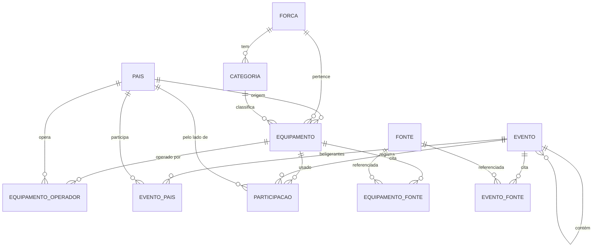

# Design: MVP do Poder Bélico

## Contexto
Site de leitura intensa, volume pequeno de dados (centenas de equipamentos,
dezenas de eventos). Prioridades: ficha técnica consistente, ligação
equipamento-evento e fontes rastreáveis.

## Decisões

### 1. Campos comuns em colunas, específicos em JSON
Navio, aeronave e tanque têm fichas diferentes. Os campos comuns ficam em
colunas normais (filtráveis e indexáveis). Os específicos da categoria ficam na
coluna JSON `especificacoes`, validada por um esquema por categoria na
importação. O SQLite filtra JSON com `json_extract`. Se um campo virar filtro
frequente, é promovido a coluna.

### 2. Unidade padrão única
Velocidade em km/h, peso em kg, comprimento em m, deslocamento naval em t,
alcance em km. A interface converte para mph, nós, pés etc. na exibição.

### 3. Fontes por tabela de ligação
Duas tabelas (`equipamento_fonte`, `evento_fonte`) em vez de referência
polimórfica, para manter integridade com chaves estrangeiras.

### 4. API somente leitura na v1
Dados entram por importação, feita por um projeto de console próprio
(`PoderBelico.Importador`, que reusa a camada `Dados`). A API não expõe rotas
de escrita. Para o importador e a API conviverem no mesmo arquivo SQLite, o
banco usa modo WAL e `busy_timeout`. Elimina concorrência de escrita na API e
adia o painel de administração.

### 5. Busca com FTS5
Tabela virtual `busca` com tokenizer `unicode61 remove_diacritics 2`, para
encontrar "Jutlandia" e "Jutlândia" igualmente.

### 6. Países históricos
A URSS e outros países extintos são entradas próprias em `pais`, com
`ano_inicio` e `ano_fim`. Alemanha, Reino Unido e Japão são um país único em
todo o período. A Rússia atual (RUS) e a URSS (SUN) são países distintos.

### 7. Referência em duas camadas
Forças e categorias (fixas, com IDs estáveis) entram na migration via
`HasData`. Países e a tabela de busca FTS5 são carregados por uma semente
idempotente na inicialização (`Banco:AplicarMigracoes`).

### 8. Validação das especificações
Um esquema JSON (draft-07) por categoria, embutido no assembly, validado com
NJsonSchema. Campos desconhecidos são rejeitados (`additionalProperties: false`).

### 9. Importação
- Formato de entrada: somente JSON no MVP (as especificações são aninhadas e
  as listas de operadores e fontes não cabem em CSV). CSV fica para tabelas
  planas, em fase posterior.
- Chaves naturais: equipamento, evento e fonte por `slug`; participação por
  (equipamento, evento, país).
- Cada importação grava o registro inteiro (substitui o anterior). Campo
  ausente na ficha significa vazio. A importação nunca apaga registros que
  não estão no arquivo.
- Ordem de carga: fontes, equipamentos (com operadores e fontes), eventos
  (pai antes do filho, com beligerantes), participações, índice de busca.
- Gravação por registro, dentro de uma transação da execução, com um ponto de
  salvamento por registro. Registro que depende de um rejeitado também é
  rejeitado ("dependência rejeitada"). Falha de infraestrutura desfaz toda a
  execução.
- Opções: `--estrito` (qualquer rejeição desfaz tudo) e `--simular` (valida e
  relata sem gravar). O código de saída é diferente de zero se houver
  registro rejeitado.
- O importador também atualiza a tabela `busca`.
- Fatiamento: 3a (fontes e equipamentos), antes da etapa 4; 3b (eventos e
  participações), antes das etapas 5 e 6.

### 10. Fonte provisória e confiabilidade
A fonte tem o campo `provisoria` (origem não verificada, como uma conversa
com assistente de IA ou uma anotação própria). Ficha cujas fontes são todas
provisórias não pode ser "confirmada": o importador a grava como "estimada" e
emite aviso. A confiabilidade é obrigatória na ficha (sem valor padrão no
banco), para que "confirmado" seja sempre uma decisão explícita.

## Modelo de entidades



## DDL (SQLite)

```sql
PRAGMA foreign_keys = ON;

CREATE TABLE pais (
  id INTEGER PRIMARY KEY,
  codigo_iso TEXT NOT NULL UNIQUE,  -- ISO alpha-3 ou código do projeto (ex.: SUN)
  nome TEXT NOT NULL,
  ano_inicio INTEGER,               -- países extintos (ex.: URSS 1922)
  ano_fim INTEGER                   -- (ex.: URSS 1991)
);

CREATE TABLE forca (
  id INTEGER PRIMARY KEY,
  codigo TEXT NOT NULL UNIQUE CHECK (codigo IN ('MARINHA','AEREA','EXERCITO')),
  nome TEXT NOT NULL
);

CREATE TABLE categoria (
  id INTEGER PRIMARY KEY,
  forca_id INTEGER NOT NULL REFERENCES forca(id),
  codigo TEXT NOT NULL UNIQUE,   -- ex.: TANQUE, AERONAVE, NAVIO
  nome TEXT NOT NULL
);

CREATE TABLE equipamento (
  id INTEGER PRIMARY KEY,
  slug TEXT NOT NULL UNIQUE,
  nome TEXT NOT NULL,
  variante TEXT,
  pais_id INTEGER NOT NULL REFERENCES pais(id),
  forca_id INTEGER NOT NULL REFERENCES forca(id),
  categoria_id INTEGER NOT NULL REFERENCES categoria(id),
  fabricante TEXT,
  ano_primeiro_uso INTEGER,
  ano_entrada_servico INTEGER,
  unidades_produzidas INTEGER,
  status TEXT NOT NULL CHECK (status IN ('ATIVO','APOSENTADO','PROTOTIPO')),
  descricao_curta TEXT,
  curiosidade TEXT,
  imagem_url TEXT,
  imagem_credito TEXT,
  especificacoes TEXT NOT NULL DEFAULT '{}' CHECK (json_valid(especificacoes)),
  confiabilidade TEXT NOT NULL      -- sem valor padrão: a ficha declara
    CHECK (confiabilidade IN ('CONFIRMADO','ESTIMADO','CONTESTADO'))
);
CREATE INDEX ix_equipamento_filtros
  ON equipamento (forca_id, categoria_id, pais_id, ano_entrada_servico);

CREATE TABLE equipamento_operador (
  equipamento_id INTEGER NOT NULL REFERENCES equipamento(id),
  pais_id INTEGER NOT NULL REFERENCES pais(id),
  observacao TEXT,
  PRIMARY KEY (equipamento_id, pais_id)
);

CREATE TABLE evento (
  id INTEGER PRIMARY KEY,
  slug TEXT NOT NULL UNIQUE,
  nome TEXT NOT NULL,
  tipo TEXT NOT NULL CHECK (tipo IN ('GUERRA','CAMPANHA','BATALHA')),
  evento_pai_id INTEGER REFERENCES evento(id),
  data_inicio TEXT NOT NULL,     -- ISO 8601
  data_fim TEXT,
  local TEXT,
  descricao TEXT,
  resultado TEXT,
  confiabilidade TEXT NOT NULL      -- sem valor padrão: a ficha declara
    CHECK (confiabilidade IN ('CONFIRMADO','ESTIMADO','CONTESTADO'))
);
CREATE INDEX ix_evento_periodo ON evento (data_inicio);

CREATE TABLE evento_pais (
  evento_id INTEGER NOT NULL REFERENCES evento(id),
  pais_id INTEGER NOT NULL REFERENCES pais(id),
  lado TEXT,                     -- ex.: Aliados, Eixo, Coalizão
  PRIMARY KEY (evento_id, pais_id)
);

CREATE TABLE participacao (
  id INTEGER PRIMARY KEY,
  equipamento_id INTEGER NOT NULL REFERENCES equipamento(id),
  evento_id INTEGER NOT NULL REFERENCES evento(id),
  pais_id INTEGER NOT NULL REFERENCES pais(id),
  papel TEXT NOT NULL,           -- ex.: ataque ao solo, escolta, bloqueio
  quantidade_aprox INTEGER,
  observacao TEXT,
  UNIQUE (equipamento_id, evento_id, pais_id)
);

CREATE TABLE fonte (
  id INTEGER PRIMARY KEY,
  slug TEXT NOT NULL UNIQUE,        -- chave natural para a importação idempotente
  provisoria INTEGER NOT NULL DEFAULT 0 CHECK (provisoria IN (0,1)),
  tipo TEXT NOT NULL CHECK (tipo IN ('LIVRO','ARTIGO','SITE','ARQUIVO')),
  titulo TEXT NOT NULL,
  autor TEXT,
  ano INTEGER,
  url TEXT,
  acessado_em TEXT
);

CREATE TABLE equipamento_fonte (
  equipamento_id INTEGER NOT NULL REFERENCES equipamento(id),
  fonte_id INTEGER NOT NULL REFERENCES fonte(id),
  referencia TEXT,               -- página, seção
  PRIMARY KEY (equipamento_id, fonte_id)
);

CREATE TABLE evento_fonte (
  evento_id INTEGER NOT NULL REFERENCES evento(id),
  fonte_id INTEGER NOT NULL REFERENCES fonte(id),
  referencia TEXT,
  PRIMARY KEY (evento_id, fonte_id)
);

CREATE VIRTUAL TABLE busca USING fts5(
  tipo UNINDEXED, slug UNINDEXED, nome, descricao,
  tokenize = 'unicode61 remove_diacritics 2'
);
```

## Especificações por categoria (coluna JSON)

Todas as medidas em unidade padrão.

**TANQUE**: `motor_modelo`, `potencia_hp`, `velocidade_max_kmh`, `peso_kg`,
`tripulacao`, `armamento_principal` (`calibre_mm`, `modelo`), `blindagem`,
`alcance_km`, `torre_tripulada` (bool).

**AERONAVE**: `data_primeiro_voo`, `tripulacao`, `comprimento_m`,
`envergadura_m`, `altura_m`, `peso_vazio_kg`, `peso_max_decolagem_kg`,
`motores` (`quantidade`, `modelo`, `empuxo_lbf`), `velocidade_max_kmh`,
`alcance_km`, `teto_m`, `armamento`, `blindagem`.

**NAVIO**: `classe`, `deslocamento_t`, `comprimento_m`, `boca_m`, `calado_m`,
`propulsao`, `velocidade_max_kmh`, `alcance_km`, `armamento`, `tripulacao`.

Exemplo (A-10): `unidades_produzidas = 716`, `operadores = EUA`,
`peso_max_decolagem_kg = 23000`, `velocidade_max_kmh = 706`.

## API (somente leitura)

| Rota | Função |
|---|---|
| `GET /api/equipamentos` | Lista com filtros `pais`, `forca`, `categoria`, `de`, `ate`, `status`, `pagina` |
| `GET /api/equipamentos/{slug}` | Ficha completa, operadores, eventos, fontes |
| `GET /api/eventos` | Lista com filtros `de`, `ate`, `tipo`, `pais`, `pagina` |
| `GET /api/eventos/{slug}` | Evento, beligerantes, subeventos, equipamentos, fontes |
| `GET /api/paises` e `/api/paises/{codigo}` | Países e resumo por país |
| `GET /api/linha-do-tempo` | Eventos ordenados por data, filtro `forca` |
| `GET /api/busca?q=` | Busca textual agrupada por tipo |

## Riscos
- Fichas de equipamentos recentes ou secretos dependem de estimativas:
  mitigado pelo indicador de confiabilidade.
- Fotos e textos de terceiros: usar apenas imagens livres (Wikimedia Commons)
  com crédito, e texto próprio.
- Esquema JSON diverge entre fichas: mitigado por validação na importação.
- Fichas vindas de conversas com assistentes de IA podem conter erros:
  mitigado por fonte provisória e confiabilidade "estimada" até a revisão
  com fonte original.
